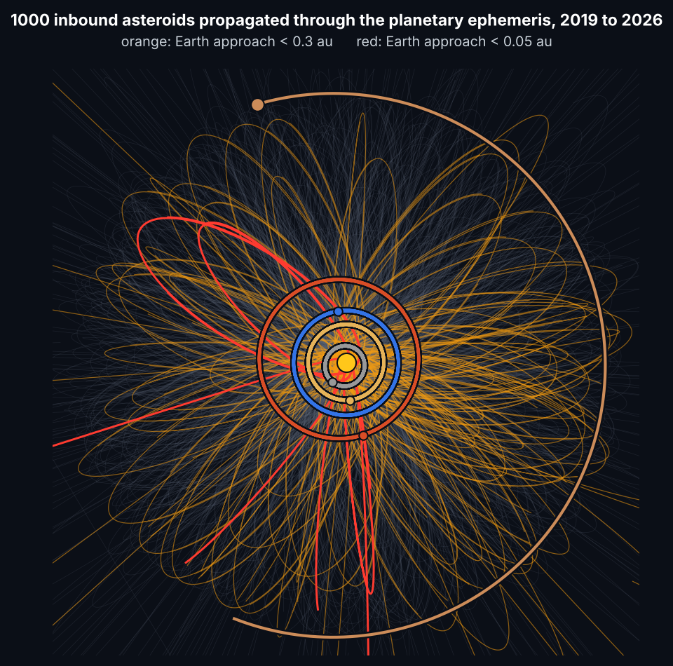
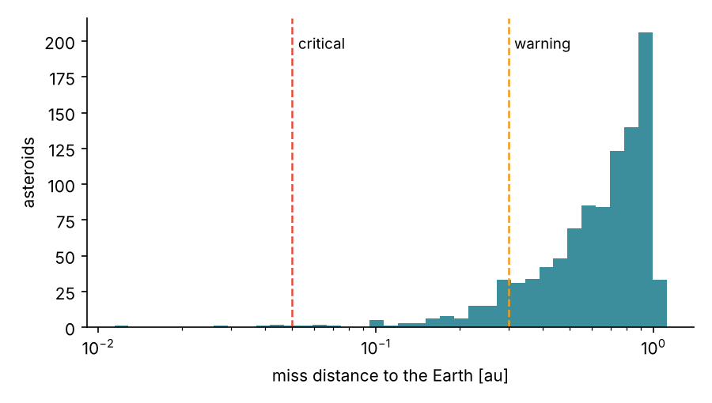
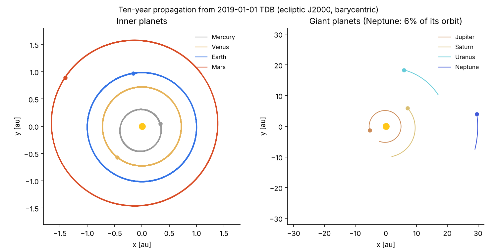
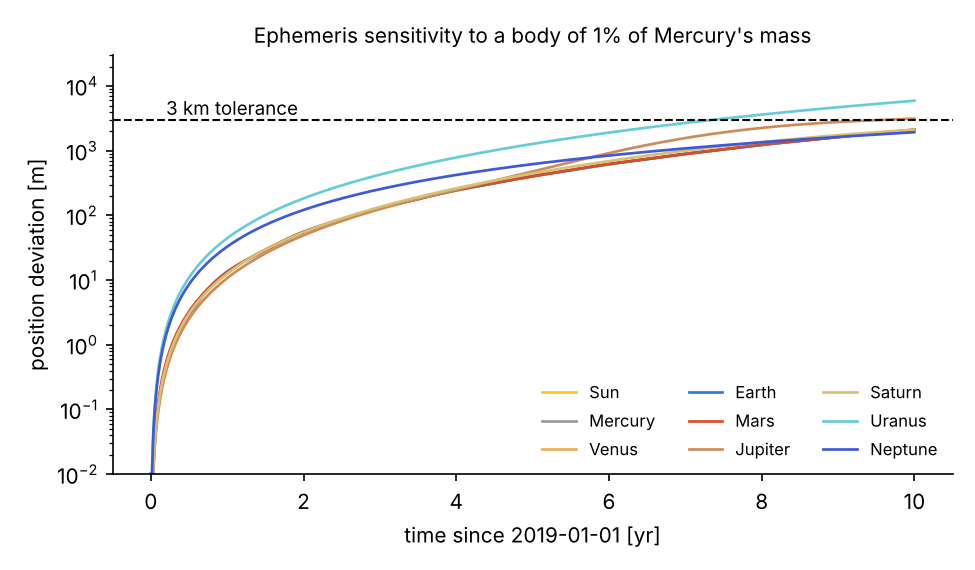
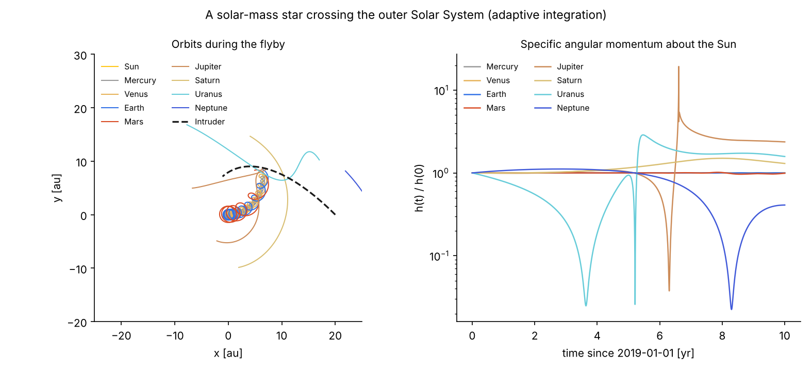

<h1 align="center">Solar System N-body Propagator</h1>

<p align="center">
<b>Orbit propagation, close-approach screening and Monte Carlo impact assessment in MATLAB</b>
</p>

<p align="center">
<a href="https://github.com/EdwardOlex/solar-system-nbody/actions/workflows/tests.yml"></a>


<a href="LICENSE"></a>
</p>

<p align="center">

</p>

A gravitational N-body propagator for the Solar System, written from scratch in MATLAB, with the
tools needed to answer planetary-defence questions: where an inbound asteroid will go, how close it
will come to each planet, when, and how likely an impact is.

Starting from JPL Horizons state vectors of the Sun, the eight planets and the Moon, the code
propagates the full system, injects populations of asteroids as test particles, screens every
trajectory against every planet with sub-step resolution, and turns the Monte Carlo sample into
impact probabilities. The same engine is used to study how the planetary ephemeris responds to
perturbing bodies, stellar flybys and changes in planetary mass.

## Capabilities

- **Ephemeris propagation.** Direct-summation Newtonian dynamics for the Sun, planets and Moon (or any
  set of massive bodies) from barycentric state vectors in the ecliptic J2000 frame.
- **Two integrators.** A fixed-step second-order explicit midpoint scheme for fast production runs, and
  an adaptive Dormand-Prince 4(5) scheme (`ode45`, relative tolerance 1e-11) for close encounters.
- **Restricted N-body propagation of asteroids.** Any number of massless bodies propagated through the
  precomputed planetary ephemeris, at a cost linear in the number of particles.
- **Monte Carlo sampling** of inbound asteroid populations: isotropic injection on a spherical shell with
  randomised approach directions.
- **Close-approach screening.** Miss distance, time of closest approach (TCA) and first entry into
  configurable alert zones for every asteroid and every planet. Encounters are resolved between
  integration epochs, so a fast object that crosses a planet within one step is not missed.
- **Impact assessment.** Number of warning, critical and impact events per planet, impact probability
  with its binomial uncertainty (or the 95% upper limit when no impact occurs), and the calendar date
  of each event.
- **Perturbation analysis.** Epoch-by-epoch comparison of a nominal and a perturbed ephemeris, reporting
  which bodies leave a given position tolerance and when.
- **Time-varying masses**, for scenarios such as a planet accreting mass.
- **Verification diagnostics.** Total energy, linear and angular momentum, and the specific angular
  momentum of each body about the Sun (Kepler's second law).

## Validation

The test suite ([`tests/run_tests.m`](tests/run_tests.m)) checks the code against analytical
solutions, conservation laws and the JPL Horizons ephemeris:

| Check | Result |
|---|---|
| Pairwise accelerations against an explicit double loop | relative error 3e-16 |
| Circular two-body orbit closes after one period (20 000 steps) | 4e-7 au |
| Solar System, 2 years, 1 h step: energy / angular momentum drift | 7e-9 / 2e-10 |
| Earth position after one year vs JPL Horizons (1 h step) | 326 km |
| Earth position after one year vs JPL Horizons (`ode45`) | 57 km |
| Jupiter position after one year vs JPL Horizons | 6e-5 of its distance |
| Asteroid crossing a planet between two epochs | detected, entry time exact |

The remaining difference with JPL Horizons comes from what the model leaves out on purpose:
the asteroid belt, Pluto and the other dwarf planets, general relativity and the non-spherical shape
of the bodies.

## Quick start

```matlab
addpath src
c = constants();
rng(2019);

sys  = solar_system_initial_state();                       % JPL Horizons, 2019-01-01 00:00 TDB
traj = propagate_nbody(sys, 7 * c.YEAR, 10228);            % 7 years, 6 h step

[rp0, vp0] = sample_asteroid_cloud(1000, 5 * c.AU, 3e-3 * c.AU / c.DAY);
part = propagate_test_particles(traj, rp0, vp0);

enc = close_approach_screening(traj, part, planetary_targets({'Earth', 'Mars', 'Jupiter'}));
encounter_report(enc, traj.epoch, 1000);
```

```
 EARTH
   warning   (d <     0.300 au)   :   102
   critical  (d <     0.050 au)   :     5
   impact    (r <      6371 km)   :     0
   impact probability             : < 0.0030 (95% upper limit, no impacts)
   closest approach               : 1.901e+06 km (asteroid 216, 2020-06-03 05:55)
```

(Output from GNU Octave. MATLAB's random number generator draws a different, statistically
equivalent sample.)

<p align="center">

</p>

## Examples

| Script | Scenario |
|---|---|
| [`ex01_solar_system_propagation`](examples/ex01_solar_system_propagation.m) | Nominal ten-year propagation of the Solar System, with conservation diagnostics and optional animation |
| [`ex02_stellar_flyby`](examples/ex02_stellar_flyby.m) | A solar-mass star crossing the outer Solar System; Jupiter's 0.03 au encounter is followed with the adaptive integrator |
| [`ex03_perturbation_sensitivity`](examples/ex03_perturbation_sensitivity.m) | Which planets are displaced by more than 3 km by a body of 1% of Mercury's mass, and from which date |
| [`ex04_jupiter_mass_growth`](examples/ex04_jupiter_mass_growth.m) | Jupiter grows into a second Sun over 20 years: a chaotic, time-varying-mass problem solved with the adaptive integrator |
| [`ex05_asteroid_impact_monte_carlo`](examples/ex05_asteroid_impact_monte_carlo.m) | Monte Carlo close-approach and impact assessment of 1000 inbound asteroids against six bodies |

<p align="center">

</p>

<p align="center">

</p>

<p align="center">

</p>

## Method

**Dynamics.** Every massive body feels every other one through Newtonian point-mass gravity,

```
a_i = - sum_{j != i} GM_j (r_i - r_j) / |r_i - r_j|^3
```

evaluated by vectorised direct summation. Gravitational parameters are those of the JPL DE440
ephemeris. Asteroids are massless test particles: they feel the Sun, planets and Moon but do not act
on them (restricted N-body problem), so the planetary ephemeris is computed once and reused for the
whole Monte Carlo population.

**Integration.** The default scheme is the explicit midpoint method,

```
r(k+1/2) = r(k) + v(k) dt/2         v(k+1/2) = v(k) + a(r(k)) dt/2
r(k+1)   = r(k) + v(k+1/2) dt       v(k+1)   = v(k) + a(r(k+1/2)) dt
```

second-order accurate and cheap enough for decades of propagation with thousands of particles. A
step of a few hours is enough for the planets; the Moon's orbit needs about two hours or less. For
close encounters between massive bodies the adaptive `ode45` option controls the error
automatically.

**Encounter screening.** Between two consecutive epochs the motion of an asteroid relative to a
planet is taken as linear. The minimum of the relative distance in each step and the first crossing of
each alert sphere are then found analytically, which gives the miss distance, the time of closest
approach and the time of entry into each zone without refining the time step.

**Statistics.** With *n* impacts out of *N* sampled asteroids the impact probability is *p = n/N*, with
uncertainty *sqrt(p(1-p)/N)*. When no impact is found the report gives the 95% upper limit *3/N*.

**Default alert zones** ([`planetary_targets`](src/planetary_targets.m)): 0.30 au (warning) and
0.05 au (critical) for the terrestrial planets and the Moon, the latter matching the 0.05 au
threshold used to classify potentially hazardous asteroids; 1.0 au and 0.3 au for the giant planets.
Impact is declared within the mean radius of the body. All of them can be changed.

## Repository layout

```
src/
  solar_system_initial_state.m   JPL Horizons state vectors, DE440 GM values, radii
  add_body.m                     add a massive body (intruder, perturber, spacecraft...)
  propagate_nbody.m              N-body propagation (midpoint or ode45)
  propagate_test_particles.m     restricted N-body propagation of asteroids
  sample_asteroid_cloud.m        Monte Carlo initial conditions
  close_approach_screening.m     miss distance, TCA, alert-zone entry, impacts
  encounter_report.m             impact probabilities and event list
  compare_trajectories.m         nominal vs perturbed ephemeris
  conservation_diagnostics.m     energy, momentum, angular momentum
  planetary_targets.m            default alert zones
  plot_orbits.m, plot_impact_assessment.m, animate_orbits.m
examples/                        five ready-to-run scenarios
tests/run_tests.m                verification and validation suite
```

## Requirements and tests

MATLAB R2016b or later, or GNU Octave 6 or later. No toolboxes are needed.

```matlab
addpath tests
run_tests
```

The tests also run automatically on GitHub with GNU Octave at every push.

## Model assumptions

- Newtonian point masses; no relativistic, tidal or non-gravitational forces (Yarkovsky effect,
  outgassing, radiation pressure).
- The Sun, the eight planets and the Moon only. Planetary GM values include their satellites.
- Asteroids do not perturb the planets or each other.
- Initial conditions are fixed at 2019-01-01 00:00 TDB; other epochs require new state vectors from
  JPL Horizons.

## Author

Edward Olex, Universidad Autónoma de Madrid.
Contact: [edward.olex@uam.es](mailto:edward.olex@uam.es)

## License

MIT. See [`LICENSE`](LICENSE).
